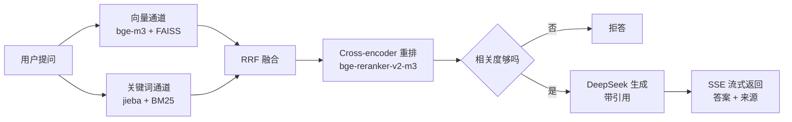

# HealthRAG · 知健

生活与健康领域的检索增强问答服务。提出问题，它从资料库里检索相关片段，
**基于片段作答并逐条标注来源**；资料不足时直接说不知道。

覆盖完整链路：语料采集 → 结构感知切分 → 混合检索 → 重排 → 带引用生成 → 流式服务 → 容器化部署。

**在线演示**：<https://health.liyixin.asia>

> 本项目仅供科普参考，不构成医疗建议。

## 核心设计

把几段文本塞进 prompt 谁都会写，难点在于**检索到底准不准**，以及**怎么证明它准**。
这个项目把这两件事当作核心问题来做：

- **双通道召回 + 加权 RRF 融合**。纯向量检索对专有名词和精确术语不敏感
  （`BMI`、`幽门螺杆菌` 容易被语义相近的概念挤掉），纯关键词检索又抓不住
  「血压高吃什么好」和「高血压的饮食建议」这种换说法的提问，所以两路各召回一批，
  用 **RRF（倒数排名融合）** 合并。RRF 确实不用在两个尺度不同的分数之间做归一化，
  **但 k 和通道权重必须调** —— 实测等权融合时 `hybrid` 的 Recall@1 反而低于纯向量，
  原因和扫参证据都写在下面「检索效果」一节。
- **Cross-encoder 重排**。双塔召回快但粗，只能判断「像不像」；把 (问题, 文档) 拼起来
  喂给 `bge-reranker` 逐词比对，精度高但慢，所以只对前 24 条候选做。
- **引用溯源**。每个事实性陈述后面标注 `[编号]`，前端点一下跳到对应原文。
- **检索不到就拒答**。查询向量与语料的最高余弦低于阈值时不调用大模型，
  直接告诉用户资料库里没有 —— 健康领域宁愿不答也不能编。
- **可量化的评测**。自建评测集跑消融，用 Recall@k / MRR 说明每个模块各自贡献了多少。
  这是本项目花力气最多、也最容易被忽略的部分。

## 检索效果

评测集 129 题（119 题域内计入召回，10 题域外只验拒答），跑在 790 篇文档 / 15446 个片段的索引上。
**评测只跑检索、不调用大模型**，所以又快又便宜，可以随时重跑；完整报告（含参数扫描表）在
[`eval/report.md`](eval/report.md)。

| 配置 | Recall@1 | Recall@3 | Recall@5 | Recall@10 | MRR@10 | 未命中 |
|------|---------:|---------:|---------:|----------:|-------:|-------:|
| `bm25` 只用关键词 | 0.547 | 0.803 | 0.855 | 0.923 | 0.687 | 9 |
| `dense` 只用向量 | **0.872** | 0.949 | 0.991 | 0.991 | 0.915 | 1 |
| `hybrid` 双通道 + RRF | 0.863 | **0.983** | 0.983 | 0.991 | **0.916** | 1 |
| `hybrid+rerank` **线上实际用的** | 0.855 | 0.966 | 0.974 | 0.974 | 0.907 | 3 |

下面五条都是从这张表、扫描表和消融实验里读出来的，其中大半对「混合检索」和「重排」这两个卖点都不太客气。

**① BM25 在前 10 条里没有任何一次独占命中。** 逐题对比两通道发现：
只有向量命中的 8 题，只有 BM25 命中的 **0 题**，两通道都命中 108 题。
也就是说第二个通道**不带来任何额外召回**，它的实际作用是**共识重排** ——
两路都认可的块被 RRF 提权，于是 `hybrid` 的 Recall@3 比纯向量高（0.983 vs 0.949），
代价是 Recall@1 掉一题（0.863 vs 0.872）。**如果只优化 R@1，本项目的最优配置就是纯向量。**
BM25 还留在链路上，是因为它在向量服务不可用时能独立兜底（单跑 R@1 0.547），
以及默认权重下对 Top-3 有实测收益 —— 不是因为「混合检索」听起来更完整。

**② 重排的排序贡献在本评测集规模上测不出来。**
在线上索引上，从 `hybrid` 到 `hybrid+rerank` 五个指标**全部下降**：Recall@1 少 1 题、
Recall@3 少 2 题、Recall@5 少 1 题、Recall@10 少 2 题、MRR 从 0.916 掉到 0.907。
这**不是候选池口径造成的**：所有配置都只输出前 10 条，重排的候选池是融合后的前 24 条，
而 10 < 24，两边输出本来就落在同一批候选里，逐格可比。
（早先一版报告把 Recall@10 的下降解释成「口径不同」，那个解释是错的，这里更正；
`eval/report.md` 里列了被挤掉的具体题目。）

但换三套索引配置复核之后，**这个亏损并不稳定**（表见下面 ④）：

| 索引配置 | `hybrid` MRR@10 | `hybrid+rerank` MRR@10 | 增量 |
|----------|---------------:|---------------------:|-----:|
| `cs300` | 0.900 | 0.918 | **+0.019** |
| `cs450` **←** 线上 | 0.916 | 0.907 | −0.009 |
| `cs700` | 0.904 | 0.901 | −0.003 |
| `qwen3-0.6b` | 0.902 | 0.916 | **+0.014** |

四个数两正两负，最大幅度也不过 2 题（+0.019）—— 而 119 道题里 1 题就是 0.008。
所以诚实的结论是**测不出来**：既不能说重排有用，也不能说它有害，
要给一个定论得把评测集做到几百题的量级，那超出本项目范围。
回头看机理也说得通：`hybrid` 的 Recall@3 已经是 0.983，剩下的错基本不是「排序不好」
而是「候选池里根本没有」，cross-encoder 能施力的空间本来就很小。

**那线上为什么还开着**：老实说，拒答判据换成查询余弦之后（见 ⑤），
重排已经不再承担「非它不可」的职责；保留它是作为可开关的对照
（`ENABLE_RERANK=0` 可关），也是消融实验里唯一一个**敢报负增量**的模块。

**③ RRF 的 k 和权重必须调，而且本语料上第 2 个通道越弱越好。**
等权融合（1:1）时 `hybrid` 的 Recall@1 只有 0.812，比纯向量低 6 个百分点。
原因是 RRF 的 k 把名次差异压平了：k=60 时第 1 名得 1/61=0.0164，第 50 名得 1/110=0.0091，
只差一倍；于是「两路都召回但都排末尾」的块（0.0091×2=0.0182）会赢过
「只在向量通道排第一」的块。BM25 召回质量明显更差，它带进来的噪声就这样把正确答案挤下去。
把 k 调小或把 BM25 权重调小都能消除这个反常 —— 参数扫描表在
[`eval/report.md`](eval/report.md)，默认值 `RRF_K=60`、`RRF_DENSE_WEIGHT=1.0`、
`RRF_BM25_WEIGHT=0.1` 就是从那张表里选的：在 k=60 这一行里，权重从 0.0 调到 0.1，
Recall@1 让出 1 题，而 Recall@3 多命中 4 题（0.949 → 0.983）、MRR 还略升。
线上链路是「融合取 24 条候选 → 重排取 6 条」，R@3 决定的正是候选池里有没有正确答案，
所以这笔交换划算。

**④ 块长和向量模型都换了，指标几乎不动 —— 瓶颈不在这两个超参上。**
`eval/ablation.md` 建了四套索引各跑一遍完整评测，每次只改一个变量，语料和评测题都不变：

| 索引配置 | 块长 | 向量模型 | 块数 | `hybrid` R@5 | `hybrid` MRR@10 |
|----------|-----:|----------|-----:|-------------:|----------------:|
| `cs300` | 300 | `BAAI/bge-m3` | 20705 | 0.983 | 0.900 |
| `cs450` **←** 线上 | 450 | `BAAI/bge-m3` | 15446 | 0.983 | 0.916 |
| `cs700` | 700 | `BAAI/bge-m3` | 12106 | 0.974 | 0.904 |
| `qwen3-0.6b` | 450 | `Qwen/Qwen3-Embedding-0.6B` | 15446 | 0.983 | 0.902 |

块长从 300 拉到 700，块数差了 1.7 倍（20705 → 12106），R@5 只动 1 题。
本语料是维基条目，一个块大致对应一个小节，300 字和 700 字都没把不相关内容混进来。
向量模型换成另一个家族的同级模型（`Qwen3-Embedding-0.6B`，同样 1024 维，
**不是拿大模型碾压小模型**），也只有 1~2 题的差别。

**既然四行分不出高下，就不该照着分数选。** 线上取 `cs450` 不是因为它在表里最高 ——
在重排行里它反而最低 —— 而是四行差距都落在噪声内、按效果选不出来时，才轮到工程因素：
块短一点，引用弹出来的片段更精确、提示词更短，同时也没短到把一个小节切碎。
**这张表真正的信息量在于：想再往上提检索质量，该动的是语料和评测集，不是这两个超参。**

**⑤ 拒答判据换过一次：从重排分改成查询向量余弦 —— 换完两面都干净了。**

早先的线上判据是「重排分 < `MIN_RERANK_SCORE`」：10 道域外题拒掉 8 道（80%），
117 道可答题里误拒 3 道（2.6%）。误拒的这三道**正确答案在融合阶段就已经排在第 1~2 名**，
是重排把它打到阈值以下的：

| 被误拒的域内题 | 重排分 | 正确答案在融合阶段的名次 |
|----------------|-------:|-------------------------:|
| 心跳快慢和健康有关系吗 | 0.051 | 第 1 名 |
| 洗手应该洗多久 | 0.090 | 第 1 名 |
| 蛋白质每天要吃多少 | 0.096 | 第 2 名 |

> 口径和召回率一致：标注来源不在语料里的 2 道题已剔除（检索不到属于语料覆盖问题，
> 不算阈值误伤）。**早先这里拿「运动之前要不要拉伸」的重排分当误伤的例子是错的** ——
> 那道题的标注来源根本不在语料里，拒答本就是对的行为。

**抬阈值修不好这个问题**：未被拒的域内题里最低重排分是 0.423（湿疹应该怎么护理），
域外漏网的那道最高分是 0.488（这部电影的导演是谁）—— 已经交叠，要拒掉后者必然误伤前者。
**重排分分不开域内和域外。** 兜底路径 `MIN_RRF_SCORE` 更没用：RRF 分只含名次信息，
第 1 名恒为 1/(60+1) = 0.0164，够不着 0.008 的门槛，10 道域外题一道都拒不掉。

现在的判据是**查询向量与语料的最高余弦**（`MIN_QUERY_COSINE` = 0.60）。同一批题上：

| 判定依据 | 域外正确拒答 | 域内误拒 |
|----------|-------------:|---------:|
| 查询向量余弦 < 0.60（线上用的） | **10 / 10（100%）** | **0 / 117（0%）** |
| 重排分 < 0.15（旧判据，留作对照） | 8 / 10（80%） | 3 / 117（2.6%） |
| RRF 分 < 0.008（兜底） | 0 / 10 | — |

余弦分布：域内可答 **0.6408~0.8193**，域外 **0.4594~0.5780**，中间有 **0.0628** 的空档，
0.60 落在空档里，两侧各留约 0.02 余量。注意这是**在固定语料 + 固定向量模型上标定的**，
换模型必须重新标定，见「已知局限」。

## 生成侧效果

上一节量的是检索与拒答两个环节，这一节量最后一步：**找到资料之后答得怎么样**，
完整报告在 [`eval/ragas_report.md`](eval/ragas_report.md)。

**这里不报孤零零的分数。** RAGAS 是 LLM-as-judge，绝对分换个裁判模型就变，
单看 0.97 说明不了什么。所以做成**对照**：两组配置**共用同一批检索结果**，
唯一变量是 system prompt 里有没有「只依据资料作答、每个事实标 `[编号]`」这条约束 ——
两行之差就是这条约束本身的贡献，而不是「检索好」或「模型强」的混合效应。

| 配置 | faithfulness | answer_relevancy | 有效样本 |
|------|-------------:|-----------------:|---------:|
| `grounded`（线上 prompt） | 0.976 | 0.662 | 20 |
| `ungrounded`（去掉接地约束） | 0.925 | 0.664 | 20 |

> 裁判 `Qwen/Qwen3-30B-A3B-Instruct-2507`，被测生成模型 `DeepSeek-V3`，不同家族，避免自己判自己。
> 本次评分的 20 题里没有被拒答的题；脚本的规则是拒答题不进生成侧评分（没有回答可评），
> 拒答本身由 ⑤ 负责量。

**结论和「接地约束越高越好」的预期不一样，如实记下来：它的增量比预想的小。**
faithfulness 只差 0.051；answer_relevancy 两边几乎相同（0.662 对 0.664）。
后一列说明接地并没有让回答变得不切题 —— 这正是设计上愿意付的代价；
但前一列说明：**在这个语料 + 这个生成模型上，模型本来就在依据检索到的资料作答**，
prompt 那条约束贡献的是最后那几个百分点。
所以它留在链路上的定位是**兜底**（防模型偶尔凭自己的知识发挥、防资料里没有时说得很肯定），
而不是准确率的主要来源。

> 20 题、单裁判：**方向可信，量级不可信**，0.051 这个差距单看不足以下结论。
> 要给出能引用的数字，得把评测集做到几百题并换几个裁判模型交叉验证 —— 这超出本项目范围。

## 架构



## 技术栈

| 环节 | 选型 | 说明 |
|------|------|------|
| 语料 | 中文维基百科（生活与健康类目） | CC BY-SA，可复现，无需爬墙 |
| 切分 | 自研结构感知切分 | 利用章节层级，块内不跨小节 |
| 向量模型 | `BAAI/bge-m3`（1024 维） | 中文效果好，OpenAI 兼容接口 |
| 向量索引 | FAISS `IndexFlatIP` | 向量已 L2 归一化，内积即余弦 |
| 关键词索引 | BM25（`rank-bm25` + `jieba`） | 精确术语上与向量通道互补 |
| 融合 | 加权 RRF | 免分数归一化，但 k 与权重靠实测标定 |
| 重排 | `BAAI/bge-reranker-v2-m3` | cross-encoder；排序增量实测为负但落在噪声内（见 ②），可用 `ENABLE_RERANK=0` 关闭 |
| 拒答 | 查询向量余弦 | 域内 0.6408~0.8193 对域外 0.4594~0.5780，阈值 0.60（见 ⑤） |
| 生成 | `deepseek-ai/DeepSeek-V3` | OpenAI 兼容接口 |
| 服务 | FastAPI + SSE | 先推来源再推正文 |
| 部署 | Docker + Compose | 镜像不含 torch |

模型全部走云端 API，**本地不跑任何推理**，所以镜像很小、可在 2 核 2G 的低配云主机上运行。

## 快速开始

```bash
git clone https://github.com/Null-Phnix/HealthRAG.git
cd HealthRAG

python -m venv .venv
source .venv/bin/activate        # Windows: .venv\Scripts\activate
pip install -r requirements-dev.txt

cp .env.example .env             # 填入自己的 API key
python -m indexing.chunk         # 切分语料（几秒）
python -m indexing.build_index   # 建索引（1.5 万个片段，实测约 10 分钟）
uvicorn app.main:app --host 0.0.0.0 --port 8000
```

浏览器打开 <http://localhost:8000>。

仓库**已包含完整语料**（790 篇 / 采集一次要两小时，所以直接入库），
索引需要自己建一次：1.5 万个片段要过一遍向量接口。索引文件合计约 98MB，
不适合放进 git，所以用一条命令重建 —— 反正提问本来就需要 API key，
多这一步不增加额外前提。

## 配置

所有配置走环境变量，见 `.env.example`。默认使用硅基流动（OpenAI 兼容协议），
换成任何兼容的服务只需改 `EMBED_BASE_URL` / `LLM_BASE_URL` 等几个变量，代码不用动。

| 变量 | 默认值 | 说明 |
|------|--------|------|
| `EMBED_MODEL` | `BAAI/bge-m3` | 向量模型 |
| `LLM_MODEL` | `deepseek-ai/DeepSeek-V3` | 生成模型 |
| `ENABLE_RERANK` | `1` | 是否启用重排 |
| `TOP_K_DENSE` / `TOP_K_BM25` | `20` | 两通道各召回多少 |
| `TOP_N_RERANK` | `6` | 重排后喂给大模型的片段数 |
| `MIN_QUERY_COSINE` | `0.60` | 查询向量余弦低于此值拒答（换向量模型需重新标定） |
| `MIN_RERANK_SCORE` | `0.15` | 兜底：取不到余弦时退回重排分判定 |

## API

| 端点 | 方法 | 说明 |
|------|------|------|
| `/` | GET | 问答页面 |
| `/api/stream` | GET | 流式问答（SSE），参数 `q` |
| `/api/ask` | POST | 一次性问答，body `{"question": "..."}` |
| `/api/search` | GET | 只检索不生成，用来单独观察检索质量 |
| `/api/stats` | GET | 索引统计 |
| `/health` | GET | 健康检查 |
| `/docs` | GET | 交互式 API 文档 |

SSE 事件序列：

```
event: sources   data: {"sources": [...], "refused": false}   # 先给来源，前端可立即渲染引用卡片
event: token     data: {"t": "高血压"}
event: token     data: {"t": "的诊断"}
event: done      data: {"elapsed": 3.2}
```

先推 `sources` 再推正文是有意的：引用卡片不用等生成结束，感知延迟明显更低。

## 语料是怎么来的

```bash
# 1. 采集（只用标准库，可在任意 Python 3.6+ 环境运行；仓库里已有产物，一般不用重跑）
python data/crawl/fetch_wiki.py --out data/corpus.jsonl
#    加 --dry-run 可先只看会采到哪些条目，不实际抓正文

# 2. 域过滤：搜索词有歧义，会带回体育人物、电子产品之类无关条目，按术语密度剔掉
python data/filter_corpus.py --in-place
```

第二步不是可有可无的。用「运动」「压力」这类词做搜索，返回结果里必然混进
无关条目 —— 它们平时不会污染回答，但**可能被检索到并当成引用来源展示**，
演示时很难看。过滤规则是「命中健康术语 ≥5 个，或术语密度 ≥1.2/千字」，
两个条件满足其一即保留：只看绝对命中数会误杀「母乳喂养」这种短条目。

## 重新构建索引

```bash
python -m indexing.chunk --corpus data/corpus.jsonl --out data/chunks.jsonl
python -m indexing.build_index
```

单独调试检索：

```bash
python -m rag.retriever -q "高血压的诊断标准是什么"
python -m rag.generator "每天应该喝多少水" --show-context
```

## 评测

三个脚本，分别回答三个问题。前两个只跑检索、不调用大模型，所以又快又便宜，可以随时重跑。

| 脚本 | 回答的问题 | 报告 |
|------|-----------|------|
| `python -m eval.run_eval` | 每个检索模块各贡献多少？RRF 参数怎么定？拒答拒对了吗？ | [`eval/report.md`](eval/report.md) |
| `python -m eval.run_ablation` | chunk 切多大、向量模型换不换？ | [`eval/ablation.md`](eval/ablation.md) |
| `python -m eval.run_ragas` | 「只依据资料作答」这条约束值多少分？ | [`eval/ragas_report.md`](eval/ragas_report.md) |

评测集在 `eval/questions.jsonl`：129 道题，其中 119 道标注了标准答案对应的文档，
另外 10 道是健康领域之外的问题（问 Python 怎么写快排、问某支球队），
只用来检验拒答判定，不计入召回率 —— 它们没有标准文档，算进分母只会把指标压低。

**`run_eval`** 跑四种配置构成消融（`bm25` / `dense` / `hybrid` / `hybrid+rerank`），
外带一张 RRF 的 (k, 权重) 二维扫描表，以及拒答判定的**两面**（域外拒准率 + 域内误拒率）。
结论和三个反直觉的发现都在上面「检索效果」里。

**`run_ablation`** 用四套参数各建一次索引再评测，回答「chunk 切多大」「要不要换更大的
向量模型」「重排到底值多少」这三个必被问到的问题。跑一次要过几万次向量接口，
所以每个变体建完就留在 `indexing/store/<变体>/`，重跑时参数一致的变体会被跳过，
中断不用从头再烧一遍。

**`run_ragas`** 做生成侧评测，设计上避开了「报一个孤零零的分数」这个坑：
RAGAS 是 LLM-as-judge，绝对分数换裁判模型就变，所以这里做**对照** ——
两组配置**共用同一批检索结果**，唯一变量是 system prompt 里有没有「只依据资料作答」这条约束，
两行的差就是接地约束本身的贡献。裁判模型与被评的生成模型不同家族，避免自己判自己。
逐题回答缓存在 `eval/ragas_samples.jsonl`，重跑只补缺失的题，不会重复烧钱。
结论（**增量比预期的小**）和它为什么仍然留着，在「生成侧效果」一节。

## 项目结构

```
HealthRAG/
├── config.py              # 集中配置，全部走环境变量
├── data/
│   ├── crawl/fetch_wiki.py # 语料采集（纯标准库）
│   ├── crawl/extra_titles.txt # 手工补齐的条目与「俗称=规范标题」映射
│   ├── filter_corpus.py   # 语料去重 + 域过滤
│   └── corpus.jsonl       # 语料（CC BY-SA）
├── indexing/
│   ├── chunk.py           # 结构感知切分
│   ├── embed.py           # 向量化客户端
│   ├── tokenize.py        # 分词（索引与查询共用）
│   ├── build_index.py     # 建 FAISS + BM25 双索引
│   └── store/             # 索引产物（不入库，需本地构建）
├── rag/
│   ├── retriever.py       # 混合检索 + RRF
│   ├── rerank.py          # 重排与拒答判定
│   ├── generator.py       # 带引用的流式生成
│   └── pipeline.py        # 串联整条链路
├── app/main.py            # FastAPI + SSE
├── web/                   # 前端页面
├── eval/
│   ├── questions.jsonl    # 评测集（129 题，含域外题）
│   ├── run_eval.py        # 检索消融 + RRF 参数扫描
│   ├── run_ablation.py    # chunk 大小 / 向量模型消融
│   ├── run_ragas.py       # 生成侧评测（接地 vs 不接地）
│   └── report.md          # 指标报告（由脚本生成，入库）
└── tests/                 # pytest
```

## 安全边界

健康领域的产品不能只会答，还得知道什么时候**不该答**。本项目做了三件事：

1. **prompt 层**：明确要求只依据资料作答，资料里没有的一律不补充，即使模型自己知道。
2. **检索层**：查询向量与语料的最高余弦低于阈值直接拒答，不给大模型编造的机会。
3. **产品层**：涉及诊断、用药、剂量的问题只做一般性说明，并提示就医；页面顶部常驻免责声明。

## 已知局限

- 语料来自维基百科，**不是临床指南**。权威性有限，不能作为医疗依据。
- 语料以条目为单位组织，缺少时间与版本信息，无法回答「最新指南怎么说」这类问题。
- **语料覆盖有缺口**：129 道评测题里有 2 道的标准答案不在语料中 ——
  「运动之前要不要拉伸」和「鼻出血应该怎么止血」；中文维基上 `拉伸` 没有独立条目、
  `鼻出血` 条目正文不足 400 字，低于收录下限。这类题检索不可能命中，
  已从召回率里剔除并在报告中单独标注，但它说明本语料的边界就是「维基上有足够内容的主题」。
- **日常俗称依赖手工别名表**。向量模型对「抑郁症」这类俗称泛化有限，
  而维基规范标题是「重性抑郁障碍」，靠 `data/crawl/extra_titles.txt` 里的映射挂上。
  这份表是手工维护的，语料外的俗称仍可能对不上。
- **域过滤是启发式的，有误收**。过滤规则只看健康术语的出现次数与密度，
  它区分不了「跑步」（该留）和「极紫外辐射」（不该留）—— 两者命中术语数一样少。
  抽查约有 1%~2% 的条目属于误收（如「厄兆」「念 (佛教)」这类），
  它们平时不会被检索到，但**可能作为引用来源露出来**。
  要根治得换信号（比如按维基分类过滤、或要求术语出现在条目导语里），不在当前范围内。
- **拒答判据只判「领域相关」，判不了「语料里有没有答案」**。余弦在 129 题上分得很干净
  （域内 0.6408~0.8193 对域外 0.4594~0.5780，见 ⑤），但两道「问的是健康、语料却没覆盖」的题
  （运动之前要不要拉伸、鼻出血应该怎么止血）余弦是 0.6513 / 0.6477，落在域内区间里 ——
  系统不会拒答，只是拿不到正确来源。这是标定集的边界，不是阈值没调好。
  另外阈值 0.60 是在固定语料 + `bge-m3` 上标定的，**换向量模型必须重新扫**。
- **换向量模型会撞上输入长度上限**。消融实验本来想比 `BAAI/bge-large-zh-v1.5`，
  但它对单条输入有 **512 token** 的硬上限，而本语料的块里有 8.2%（1267/15446）超过这个长度，
  接口直接返回 400，实验跑到 2% 就被迫中止。最终换成同样 1024 维的
  `Qwen/Qwen3-Embedding-0.6B` 才跑完对照。`bge-m3` 没有这个限制 ——
  这也是它当默认值的理由之一。
- 未做多轮对话，每次提问相互独立。

## 开发说明

开发过程中使用 AI 辅助代码编写与文档润色；仓库内所有实验都能通过 `eval/` 下的脚本复现，
指标与结论以 `eval/report.md`、`eval/ablation.md`、`eval/ragas_report.md` 为准。

## 许可

代码：[MIT](LICENSE)。
语料：来自中文维基百科，遵循 [CC BY-SA 4.0](https://creativecommons.org/licenses/by-sa/4.0/)。
